# SwimSync architecture diagrams

## Summary (SOART)

- **Scenario:** SwimSync books places in fictional swimming sessions so that a confirmed booking always means a reserved place, motivated by being turned away from a booked swim.
- **Obstacle:** the guarantees live in a few lines of SQL inside transactions, plus a worker that runs separately. Without pictures it's hard to see where the lock is held, what's in each transaction and which process does what.
- **Action:** one diagram per view, drawn from the code as it is today. Solid lines and boxes are built; dashed ones are planned.
- **Result:** you can follow a booking from the request to the committed row, see two swimmers race for the last place, and see how a notification reaches the inbox even when delivery fails.
- **Troubleshooting:** the diagrams are only useful while they're accurate, so they're updated at the end of every phase, alongside the README.

**Contents**

1. [System context](#1-system-context)
2. [Containers (local)](#2-containers-local)
3. [API components](#3-api-components)
4. [Data model](#4-data-model)
5. [Booking a place](#5-booking-a-place)
6. [Two swimmers, one place](#6-two-swimmers-one-place)
7. [Retry after a lost response](#7-retry-after-a-lost-response)
8. [Cancelling exactly once](#8-cancelling-exactly-once)
9. [Booking states](#9-booking-states)
10. [Notification delivery](#10-notification-delivery)
11. [Drill A: instance failure](#11-drill-a-instance-failure)
12. [Drill B: database connectivity (planned)](#12-drill-b-database-connectivity-planned)
13. [Trust boundaries](#13-trust-boundaries)
14. [AWS infrastructure (designed, never deployed)](#14-aws-infrastructure-designed-never-deployed)
15. [AWS security groups](#15-aws-security-groups)
16. [Admin access and the database password](#16-admin-access-and-the-database-password)

---

## 1. System context

Who and what SwimSync deals with. The pool's front desk sits outside SwimSync: walk-ins and members admitted at the desk don't go through it, which is a known limitation, not something the MVP handles.

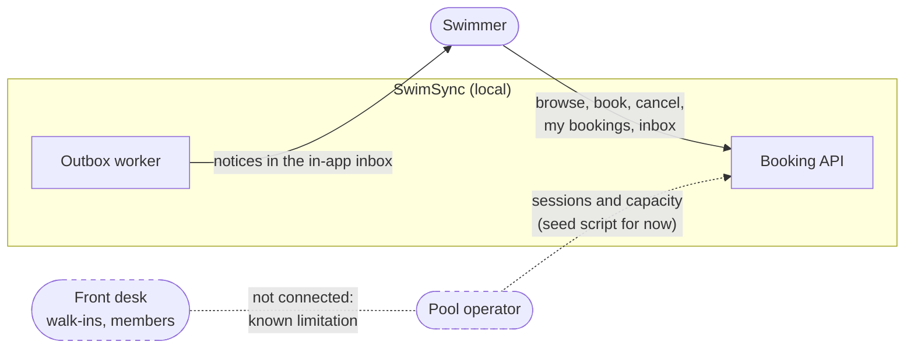

## 2. Containers (local)

The processes that run on one machine and how they talk. Everything listens on localhost only.

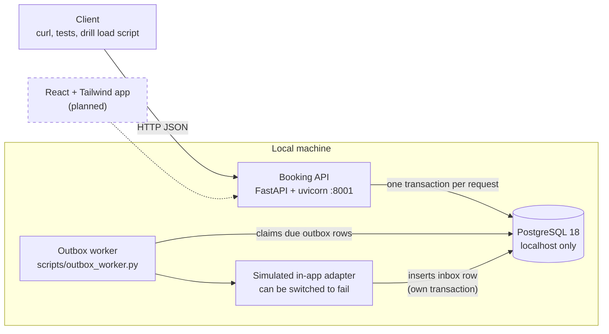

## 3. API components

How the backend code is split. `booking.py` holds every rule and never commits; the caller's `with db.connect()` block decides when the transaction ends.

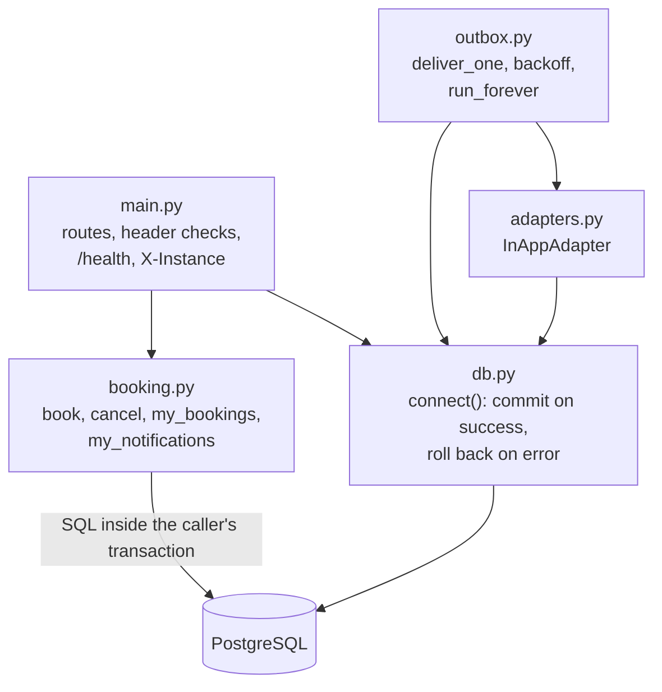

## 4. Data model

The five tables in `db/schema.sql`. The `booked` counter on `sessions` is changed only in the same transaction as the booking row it counts.

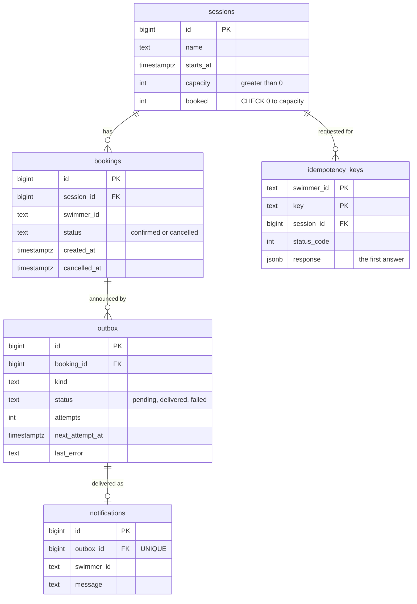

Two rules aren't visible in the diagram: a unique index allows one `confirmed` booking per swimmer per session, and `notifications.outbox_id` is unique, so one outbox row can only ever make one inbox entry.

## 5. Booking a place

`POST /sessions/{id}/bookings` with `X-Swimmer-Id` and `Idempotency-Key`. Everything between the lock and the commit is one transaction, and the answer is sent only after the commit.

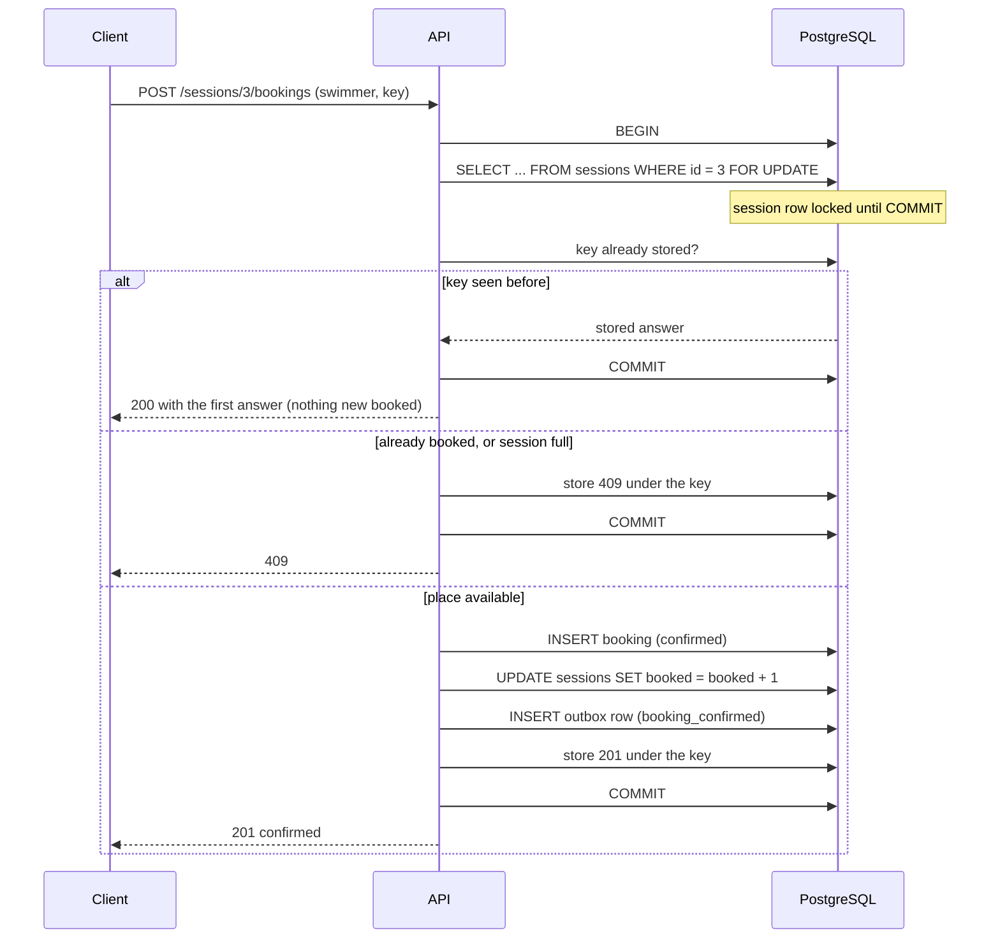

## 6. Two swimmers, one place

Why the row lock matters. Without it, both would read "9 of 10" and both would book. The test suite proves the lock works (20 swimmers for 1 place gives exactly one booking) and that removing it breaks the tests.

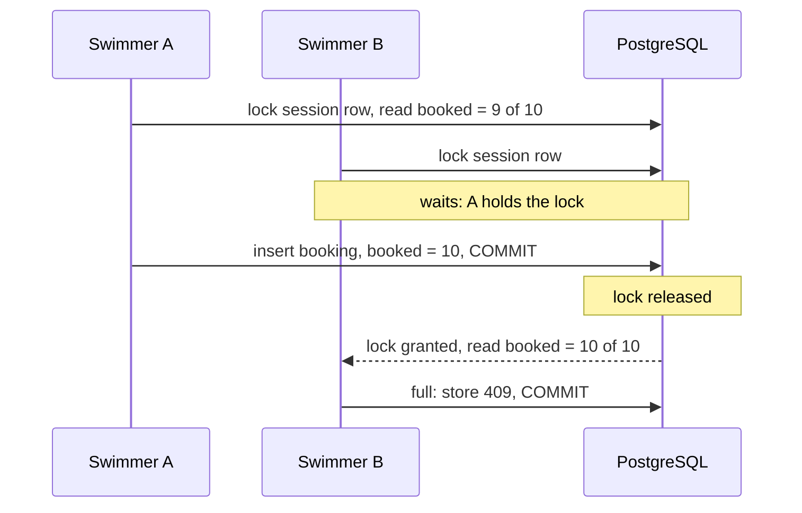

## 7. Retry after a lost response

A booking commits but the response never reaches the app (timeout, dead instance). The app retries with the same key and gets the first answer instead of a second booking.

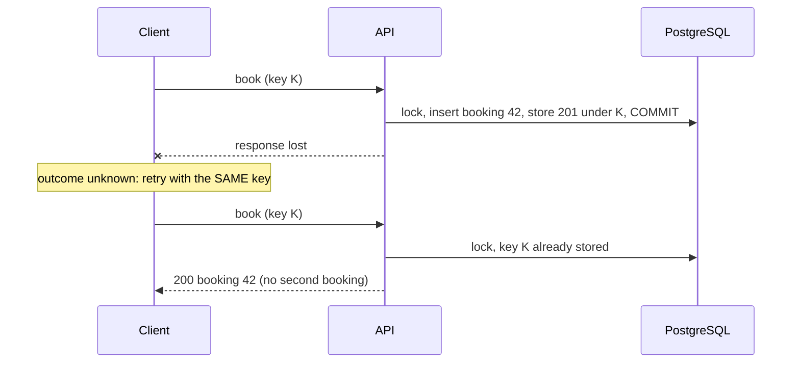

## 8. Cancelling exactly once

`POST /bookings/{id}/cancel`. The cancel takes the same session lock as booking, then releases the place only if the booking is still confirmed, so a retry or a double tap changes nothing.

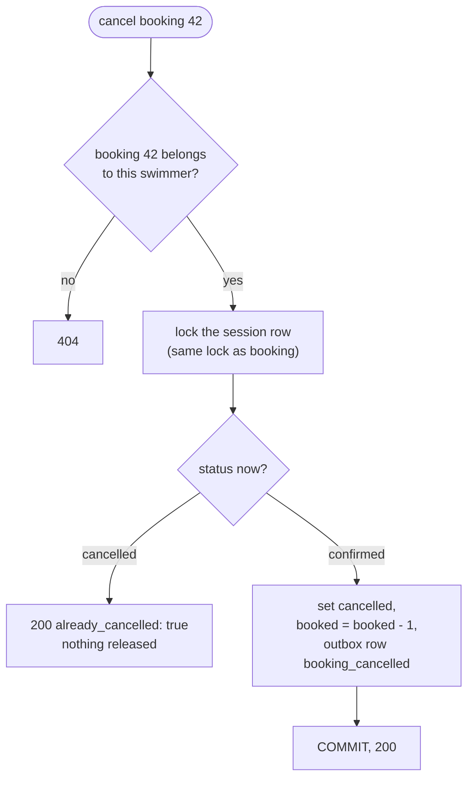

## 9. Booking states

There is no "pending" state: a request either reserves a place and becomes `confirmed` in one transaction, or it's rejected. That removes the gap between "shown as booked" and "actually reserved".

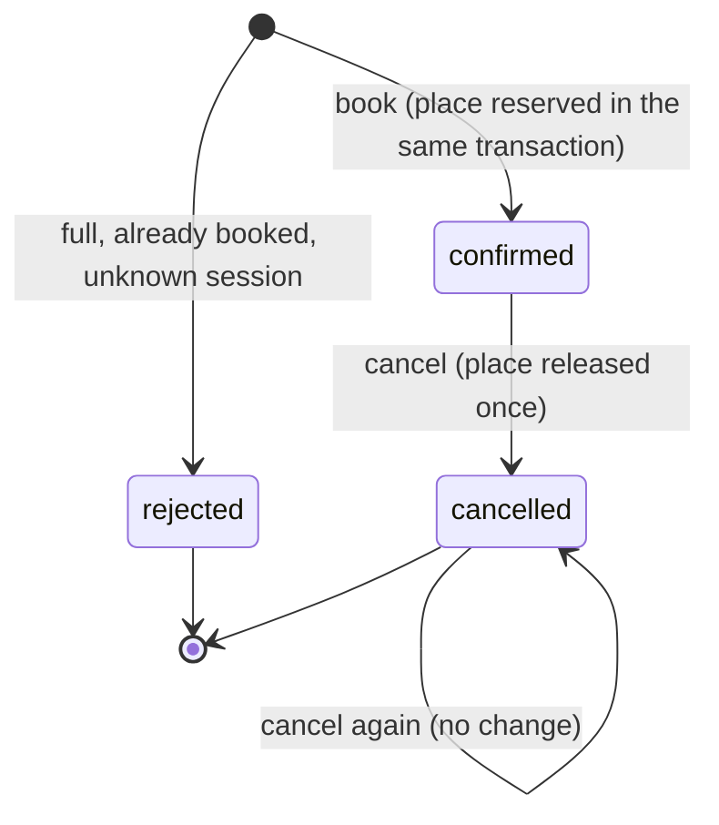

## 10. Notification delivery

The outbox row is written with the booking. The worker delivers it later, outside the booking's transaction, so a delivery failure can never change a booking. Delivery is at least once; the inbox's unique `outbox_id` turns a repeat into a no-op.

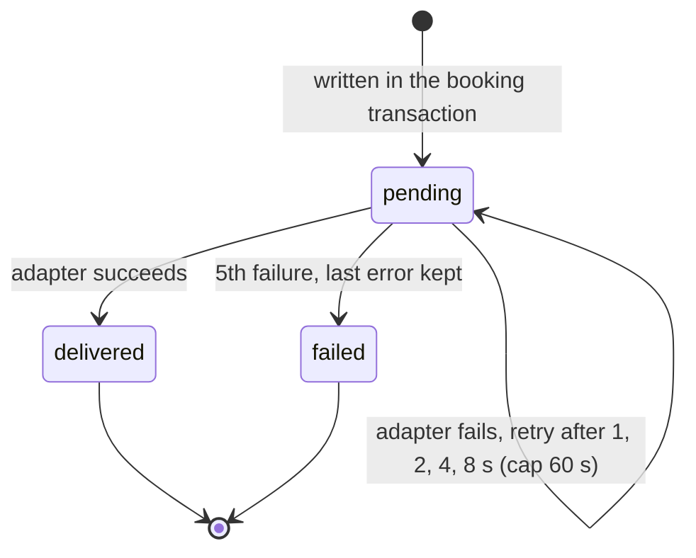

The worker claims a row with `FOR NO KEY UPDATE SKIP LOCKED`. `SKIP LOCKED` lets several workers share the queue. `NO KEY UPDATE` (not `UPDATE`) lets the adapter's inbox insert pass its foreign-key check while the worker still holds the row; with `FOR UPDATE` the two connections waited on each other forever.

## 11. Drill A: instance failure

Local experiment, not proof of AWS high availability. `drills/a/run.py` runs 30 fictional swimmers for 60 seconds, kills `a1` with `kill -9` at 20 seconds and restarts it at 40. HAProxy doesn't retry on its own (`retries 0`); the load script retries with the same idempotency key.

Two modes aim the kill at a known point. A single "victim" request (swimmer `drill-victim`, on its own session) goes straight to `a1` and is held there for 2 seconds, either before its commit (`--mode before-commit`) or after it (`--mode after-commit`). `a1` is killed half a second into that hold. Only the victim is delayed, so the load swimmers aren't slowed down. The victim then retries through HAProxy with the same key: before the commit, the booking rolled back, so the retry books fresh (201); after the commit, the booking was saved, so the retry gets the stored answer (200). Either way the database must end with exactly one victim booking.

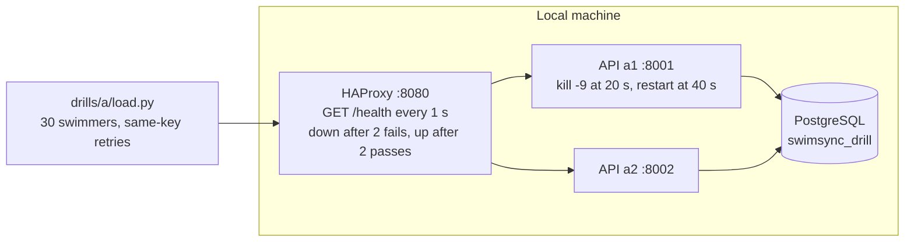

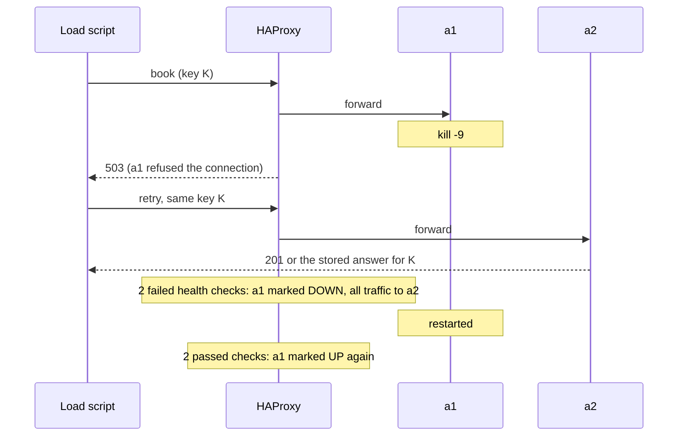

## 12. Drill B: database connectivity (planned)

Not built yet. The plan from the research: put Toxiproxy between the API and PostgreSQL to add latency, time out or cut the connection, including the case where a booking commits but the client's request times out.

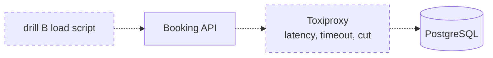

## 13. Trust boundaries

What SwimSync trusts today, and what it doesn't. The swimmer's identity is only a header: fine for a local demo, not authentication.

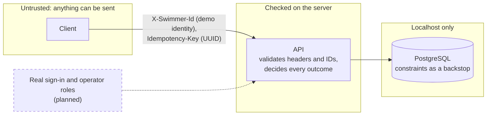

What the server never takes from the client: whether there's room, the booking's status, or the counter. The database enforces the last line of defence itself: `CHECK (booked <= capacity)`, the unique confirmed-booking index and the unique inbox `outbox_id`.

## 14. AWS infrastructure (designed, never deployed)

The AWS version of the local system, as written in `infra/terraform/` and checked with `terraform validate`. It has never been planned or applied: the account is on the Paid plan, so the ₹0 budget comes from not deploying it. Everything in this section is drawn dashed for that reason.

The region is `ap-south-1`, with one subnet of each tier in each of two zones (a and b). The mapping from what's been drilled locally: the ALB plays HAProxy, and the two app instances in two zones play `a1` and `a2`. Only the ALB can be reached from the internet. The app subnets have no internet route at all, and the database subnets only route inside the VPC.

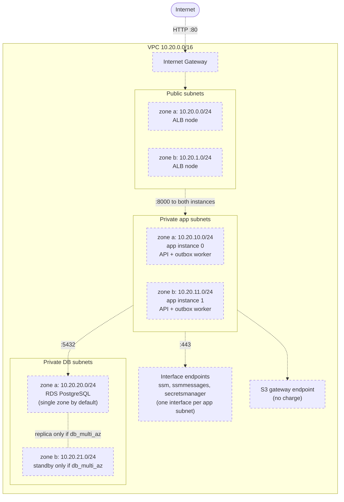

| Route table | Subnets | Routes |
|---|---|---|
| public | 10.20.0.0/24, 10.20.1.0/24 | local, and `0.0.0.0/0` to the Internet Gateway (the only internet route in the VPC) |
| app | 10.20.10.0/24, 10.20.11.0/24 | local, and S3 through the gateway endpoint |
| db | 10.20.20.0/24, 10.20.21.0/24 | local only, permanently |

What survives what: losing an app instance or a whole zone leaves the other app instance serving through the ALB, which is drill A at cloud scale. Losing the database's zone takes the database down unless `db_multi_az` is switched on, which roughly doubles the database's cost. That trade-off is deliberate and is listed as a known single point of failure.

## 15. AWS security groups

Each tier accepts traffic only from the tier in front of it, and the rules name security groups, not IP addresses, so they keep working when instances are replaced. Terraform removes AWS's default "allow all outbound" rule, so the arrows below are the only traffic allowed. There's no port 22 anywhere.

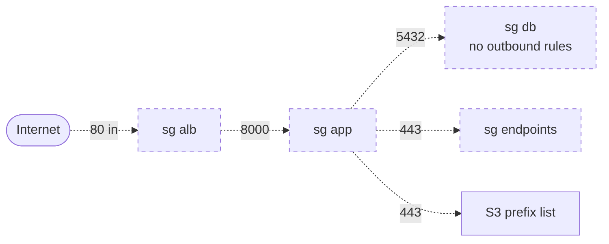

HTTP only on the ALB: HTTPS needs a certificate, a certificate needs a domain, and a domain costs money. It's a production requirement, not part of the ₹0 design.

## 16. Admin access and the database password

Nothing connects in to an app instance. SSM Agent on each instance connects out, through the interface endpoints, to Session Manager, and an operator's shell travels back over that connection. The database password is created by RDS and kept in Secrets Manager; Terraform only ever sees its ARN, and the instance role may read that one secret and nothing else.

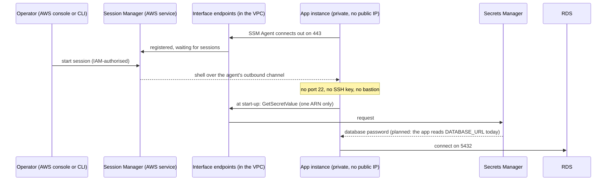

Instances also require IMDSv2 (`http_tokens = "required"`), so the instance metadata, including the role's temporary credentials, can only be read after a PUT for a session token.
